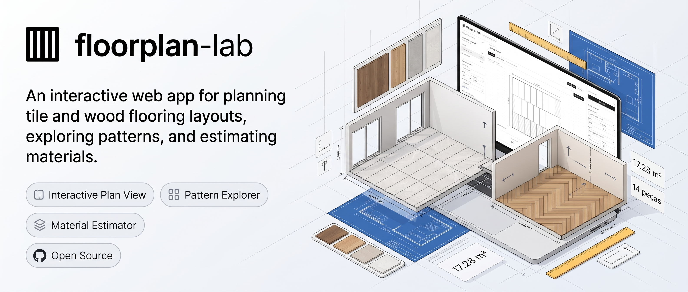
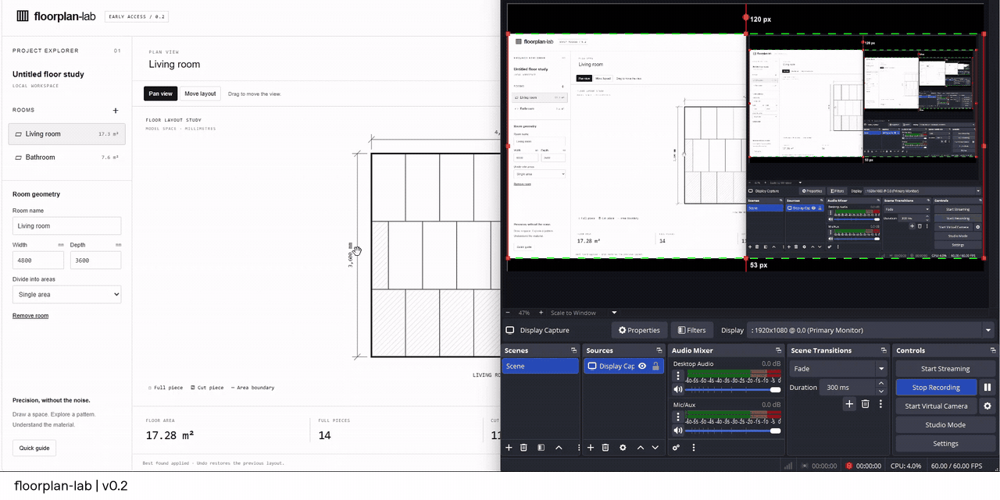

**A browser-based workspace for exploring tile and wood flooring layouts, and estimating how much material you actually need.**

Draw a room, pick a tile or plank, drag the pattern around, and watch the piece count, cuts and offcuts update live. When you're ready, let the optimizer search for the layout that wastes the least material.

Built with native JavaScript modules, SVG and CSS. No framework, no build step, no backend, no runtime dependencies.



> **Status: v0.2, functional prototype.** Rooms are rectangular and shown one at a time. This is the first working slice of a broader floor planning tool, not a full CAD system.

---

## Features

**Rooms and materials**
- Up to 20 named rectangular rooms, with dimensions in millimetres.
- Optional horizontal or vertical split into two independently configured areas.
- Square and rectangular tiles, large formats, and rectangular wood planks.
- Straight grid and half-offset running bond patterns.
- Adjustable rotation, joint width, and X/Y origin offsets.

**Quantities**
- Exact geometric clipping at room and area boundaries, with hatching on cut pieces.
- Room area, full vs. cut piece counts, and cutting offcut area.
- Per-area reserve percentage, pieces per box, box count, and cost (BRL).

**Interaction**
- **Pan view** and **Move layout** tools: drag the pattern inside an area without moving the room.
- Live quantity updates while dragging; each completed drag is a single undo step.
- Zoom, optional grid, undo/redo.

**Layout optimizer**
- Background search for the best pattern origin, with optional angle comparison (0°, 45°, 90°).
- Visual before/after preview, then **Apply** or **Keep current**.
- Runs in a Web Worker, so the UI stays responsive.

**Persistence**
- Browser-local autosave.
- JSON project export/import and SVG drawing export.
- Responsive stacked layout for smaller screens.

## Quick start

Requires **Node.js 20+** only for the dev server. There is nothing to install.

```sh
git clone https://github.com/eliza-wollinger/floorplan-lab.git
cd floorplan-lab
npm run dev
```

Then open <http://127.0.0.1:3000>.

> ES modules require HTTP, so opening `index.html` directly via `file://` will not work. You can also serve the folder with any static server (for example, VS Code Live Server).

Run the test suite:

```sh
npm test
```

Try a sample project via **Open project**:

| File | What it shows |
| --- | --- |
| `examples/bathroom.json` | A bathroom split into two areas with different materials |
| `examples/optimization-demo.json` | An offset grid that the optimizer improves from 9 source pieces down to 4 |

## How it works

### Geometry

All model values are in millimetres; SVG `viewBox` coordinates handle pan and zoom without ever changing dimensions. Each tile is transformed into world coordinates and clipped against its rectangular area using **Sutherland–Hodgman** clipping. Polygon areas then separate full pieces from cuts.

### Quantity assumptions

| Quantity | Definition |
| --- | --- |
| **Floor area** | Full rectangular surface, including joints |
| **Full pieces** | Source rectangles entirely inside the area (within numerical tolerance) |
| **Cut pieces** | Source rectangles that intersect the boundary and need trimming |
| **Cutting offcuts** | Source area minus retained piece area (excludes joints and purchase reserve) |
| **Recommended pieces** | `ceil((full + cut) × (1 + reserve / 100))` |
| **Boxes** | `ceil(recommended / pieces per box)` |
| **Cost** | Box count × box price |

**Limitations to be aware of:**
- One fresh source piece is assumed per cut. Offcut reuse, saw kerf, breakage, and manufacturer installation constraints are not simulated.
- Reserve is a user choice, not an installation recommendation.
- No perimeter movement gap is modelled yet.
- The bottom summary describes the **current room**; purchase estimates describe the **selected area** only. Materials are not pooled across rooms or areas, so there is no project-wide total yet.

Treat results as conceptual purchase estimates, and verify dimensions and installation requirements before ordering.

### Layout optimizer

Select an area, then choose **Optimize layout → Find best fit**. By default the angle is locked; an optional checkbox also tests 0°, 45° and 90°.

The search is a deterministic heuristic:

1. Sample an 8 × 8 grid of pattern origins for each angle.
2. Run three successive 5 × 5 refinements around the best sampled origin.
3. Rank candidates **lexicographically**: fewest source pieces, then fewest cuts, then smallest cutting offcut area.

The original layout is always a candidate, so a proposal can never be worse than what you started with. The result is **best found**, not a proof of global optimality. It does not account for offcut reuse, kerf, minimum strip width, installation rules, or multiple areas together.

## Project structure

```
floorplan-lab/
├── index.html              Editor controls and semantic UI
├── style.css               Monochrome, responsive layout
├── app.js                  State, interaction, history, persistence, SVG rendering
├── geometry.js             Clipping, layout, and quantity calculations
├── optimizer.js            Candidate search and ranking
├── optimizer-worker.js     Background search and progress messaging
├── server.mjs              Dependency-free dev server
├── examples/               Sample projects
├── assets/gifs/            Demo recordings
└── tests/
    ├── geometry.test.mjs   Grids, cuts, rotations, running bond, joints, limits, reserve rounding
    └── optimizer.test.mjs  Improvements, unchanged optimum, fixed angle, rotation, ranking
```

## Data and privacy

Everything stays in your browser unless you explicitly export it. Clearing browser storage removes autosaved work, so export JSON for a durable backup. Imported JSON is validated and capped at 2 MB, and projects with excessive tile counts are rejected to protect the UI.

Project files use schema version 1. Projects from v0.1 remain compatible, though v0.2 allows offsets up to ±10,000 mm, and projects using more than ±3,000 mm may not open in v0.1.

## Deploying to GitHub Pages

1. Make sure `index.html` is at the repository root.
2. Go to **Settings → Pages**.
3. Under **Build and deployment**, choose **Deploy from a branch**, then select **main** and **/ (root)**.
4. Save and open the URL GitHub provides.

All asset paths are relative, so project subpaths work. No build step, secrets, or API keys are needed, and `.nojekyll` is already included.

## Testing

```sh
npm test
```

Runs 14 automated tests with the built-in Node test runner, covering geometry and the optimizer. Interaction features (dragging, undo/redo, optimizer preview, persistence, exports) have been checked manually in desktop browsers. Mobile styles are included but have not yet been tested on physical devices.

## Roadmap

Not implemented yet:

- [ ] Freeform polygons, holes, pillars, and vertex editing
- [ ] All rooms on a shared apartment drawing
- [ ] Image import with scale calibration, and DXF import
- [ ] Hexagonal tiles, herringbone, chevron, and modular patterns
- [ ] More than two areas per room, material catalog, project-wide totals
- [ ] Perimeter gaps, thresholds, skirting, cut optimization, offcut reuse
- [ ] Scenario comparison and PDF quantity reports

Native DWG import is also under consideration, but needs a separate compatibility and licensing decision.

## Contributing

Issues and pull requests are welcome. Please run `npm test` before opening a PR.

## License

No license has been specified yet.